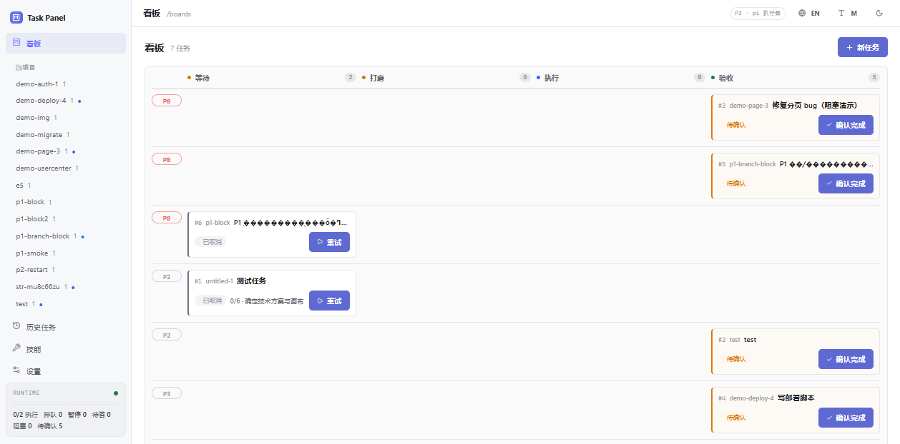
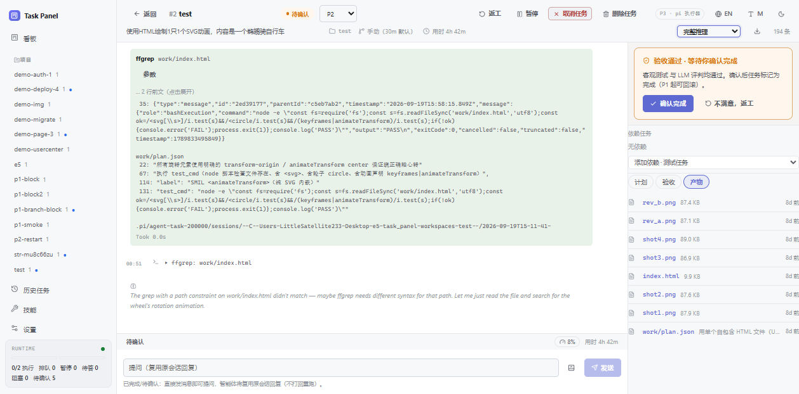
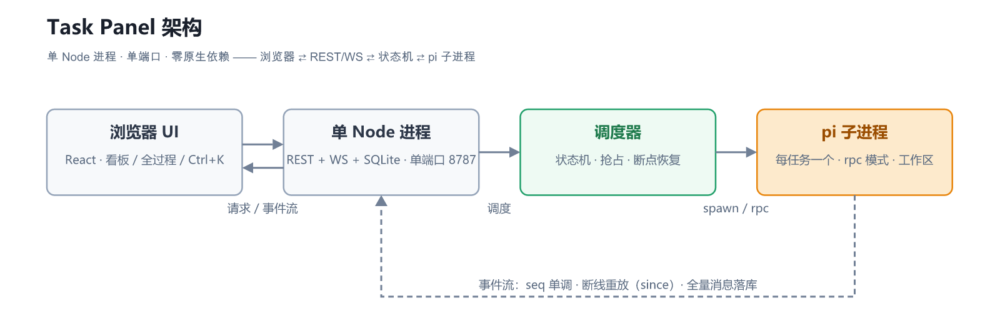
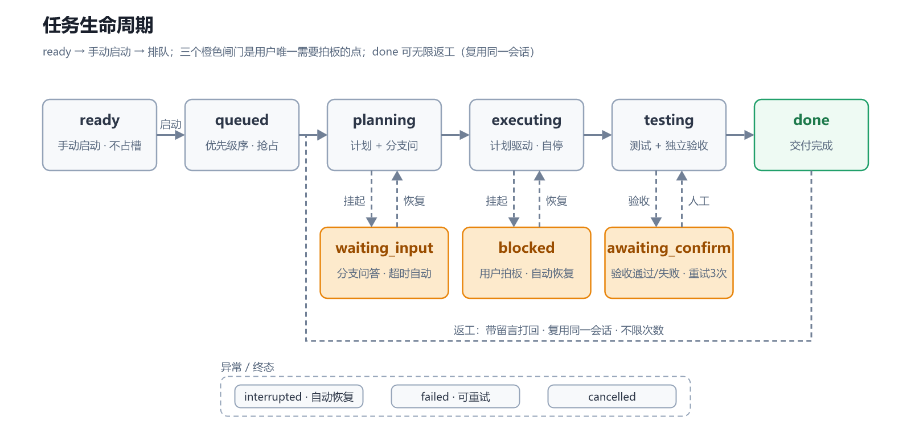
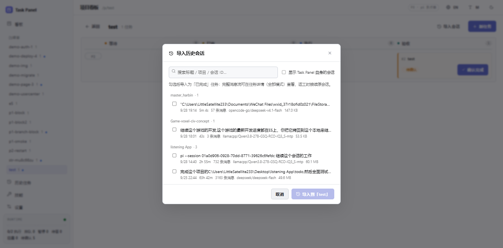

<p align="center">
  
</p>

<h1 align="center">Task Panel</h1>

<h2 align="center">别让显卡摸鱼</h2>

<p align="center">
  给 <a href="https://github.com/badlogic/pi-mono">Pi coding agent</a> 的任务调度队列。
  批量创建任务，设好并发和优先级，智能体按序执行 —— 面向本地部署。
</p>

## 为什么

本地模型智商够，但做事慢。原生 pi 只能在当前会话里干活：agent 把会话里的
任务干完就停下了，显卡接着去摸鱼；人要坐在窗口前盯进度。

Task Panel 把任务从会话里拆出来，一次性创建好所有任务，干完一个还有下一个：

- 每条任务是一个独立的 `pi` 子进程 + 独立工作区，不干扰你正在进行的交互会话；
- 调度器把并发槽位（默认 2，可调）排满 —— 多流并行，总吞吐量比单流串行有明显提升；
- 队列不空，agent 就一直有活干，显卡不摸鱼；
- P0–P3 优先级：槽位满时 P0/P1 可抢占运行中的 P2/P3（stop + checkpoint + 断点恢复）；
- 每条任务自主走完 规划 → 执行 → 测试 → 独立验收；人只在三个闸门出现（分支问答 / 阻塞决策 / 验收确认），且都有超时自动兜底；
- 回来时在总表上检查已完成任务、留修改意见，框架自动调度重跑（返工复用同一会话，不限次数）；
- 全程落库：思考、工具调用、验收判定、交付物，可查、可预览、可导出。

适合能独立验收的中小任务（修 bug、功能点、脚本、调研）。需要人全程盯守的大任务，还是在原生会话里做。

典型用法：方便时建好一批任务 → 设并发和优先级 → 离开 → 偶尔回来检查、留意见，重跑交给框架。

<p align="center">
  
</p>

## 功能

- **优先级调度**：P0–P3 + 最大并发槽位（默认 2，可调）；队列按优先级排序，P0/P1 可抢占运行中的 P2/P3；拖动排序、任务依赖（父先于子）。
- **自主任务流**：每任务一个 `pi --mode rpc` 子进程，自主完成 规划（`work/plan.json` + 分支问答）→ 执行（plan 驱动）→ 测试（`test_cmd`）→ 独立验收官逐项判定（`work/review.json`，重试 ≤3 次，用尽转人工）。
- **看板与总表**：四阶段看板（等待/打磨/执行/验收）+ 跨项目总表，状态高亮随任务左→右移动。
- **人机协同**：分支问答（手动/超时自动）、阻塞决策卡（`block.json` 即停，拍板后带决策恢复）、执行中实时 steer、留言板、done 后无限返工。
- **完整过程**：事件流全量落库 —— 系统提示词（灰盒可折叠）、阶段注入、思考、工具调用/结果、子代理框；「摘要 / 完整推理」双模式 + 分组筛选 + 导出 JSON。
- **资产预览**：工作产物/事件流里的文件可点开（图片直渲、JSON/代码/Markdown 全文、二进制下载）。
- **历史会话导入**：Pi 的历史会话（`~/.pi/agent/sessions`）可导入为「已完成」任务，完整消息流可查，返工接续原会话。
- **技能三级**：全局（只读继承）/ 项目层 / 任务级（手动安装 skill 或 extension）。
- **工程化**：单 Node 进程、单端口、零原生依赖；重启自动断点恢复；双主题；中英双语；⌘K 命令面板。

<p align="center">
  
</p>

## 快速开始

```bash
npm install
npm run build        # 构建前端 → dist/
npm start            # 单端口 8787：API + WebSocket + 静态文件
```

- 界面：<http://localhost:8787>
- 端口 `TP_PORT`、数据目录 `TP_DATA_DIR` 可覆盖（默认 `./data`）
- 开发模式：`npm run dev`（tsx watch + vite 5173，代理 `/api` 与 `/ws`）

## 架构

<p align="center">
  
</p>

- 单 Node 进程、单端口、零原生依赖：express（REST）+ ws（事件流）+ `node:sqlite`（WAL）。
- 执行器：每任务一个 `pi --mode rpc` 子进程（cwd = 任务工作区）；JSONL 协议，`agent_settled` 判静止，`extension_ui_request` 无人值守自动应答。
- 事件流：每任务 `seq` 单调，WS 断线按 `since` 重放；全量消息落库，前端直接消费。
- 前缀缓存安全：全局系统提示词固定在 `<workspace>/.pi/APPEND_SYSTEM.md`；任务交互全部 append-only（`switch_session` = 字节级重放）。
- 跨平台：Ubuntu / Windows 行为一致。

## 任务生命周期

<p align="center">
  
</p>

`ready →（手动启动）→ queued → planning → [waiting_input] → executing →
[blocked] → testing → awaiting_confirm → done`；另有 `interrupted / failed /
cancelled`（可恢复/可重试）。

| 闸门 | 触发 | 恢复 |
| --- | --- | --- |
| `waiting_input` | 规划期分支问题（手动模式） | 逐题回答；超时（默认 30min，可调）按推荐自动进入 |
| `blocked` | 执行期写 `work/block.json` | 决策卡拍板 → 带决策注入恢复（全量上下文重放） |
| `awaiting_confirm` | 验收通过 / 重试 3 次用尽 | 确认 → `done`；或带留言返工（重新打磨，复用同一会话） |

## 历史会话导入

<p align="center">
  
</p>

项目看板页 →「导入会话」：扫描 `~/.pi/agent/sessions`（`TP_SESSIONS_DIR` 可覆盖），按项目分组、搜索、多选。导入结果：

- 任务为「已完成」，工作区 = 原会话目录，产物面板直接列原项目文件；
- 完整消息流在「完整推理」模式查看（导入任务自动切到该模式）；
- `checkpoint` 指向原会话 JSONL，返工/提问时 `switch_session` 接续原会话；
- 路径限定在会话目录内（防穿越），单段文本 20k 截断，不改动原文件。

## 测试

三层，由快到慢；日常回归跑前两层（秒级，无需 Pi/模型服务）：

| 命令 | 内容 | 依赖 |
| --- | --- | --- |
| `npm test` | 后端 API 套件（node:test）：全生命周期 / 分支 / 阻塞 / 验收重试 / steer+留言 / 附图+防穿越 / 取消 / WS 实时+重放 / 重启恢复 / 优雅退出 / 优先级抢占 / P3 / 会话导入，28 项 | 无（stub 执行器） |
| `npm run test:ui` | UI 人形测试（puppeteer-core）：建看板→建任务→分支回答→确认→入 done 列；steer、主题/语言切换 | 本机浏览器（`TP_BROWSER`） |
| `npm run test:e2e` | 真实 Pi + 模型服务全链路冒烟（hello.txt 任务）；模型不可达时跳过 | Pi 已登录 + 模型在线 |

后端测试用 `TP_EXECUTOR=stub`：`server/src/runner-stub.ts` 是确定性执行器（接口与真实 TaskRunner 一致），任务标题带标记切换剧本：`#branch` / `#block` / `#fail` / `#slow`。

## 目录结构

```
server/src/   db(schema) · bus(WS) · api(REST) · scheduler(状态机) · executor(PiSession) ·
              runner(规划/执行/阻塞/测试/验收/恢复) · runner-stub(测试执行器) ·
              sessions(历史会话扫描/导入) · skills(三级扫描/安装) · prompts(阶段模板)
web/src/      styles(设计令牌) · lib(api/ws/md) · i18n(zh/en) · components(弹窗/命令面板) ·
              pages(Boards/ProjectBoard/TaskDetail/Skills/Settings/History)
test/         helpers(起服基建) · backend.test(后端套件) · ui.test(UI 人形) · e2e-pi(真实冒烟)
docs/         design/(设计文档包 00-06) · src/(SVG 图源) · images/(渲染产物) · render.mjs
workspaces/   各任务的独立工作区（运行时生成，不入库）
```

## 文档

设计文档在 [docs/design/](docs/design/)：00 总览 → 01 UI 调研 → 02 设计系统 →
03 信息架构 → 04 页面规格 → 05 架构 → 06 实施路线。

图表源文件在 `docs/src/*.svg`，`npm run docs:render` 可确定性重渲染（resvg-js → `docs/images/*.png`）。

## License

[MIT](./LICENSE)
